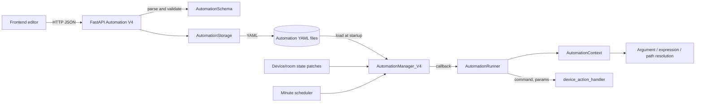
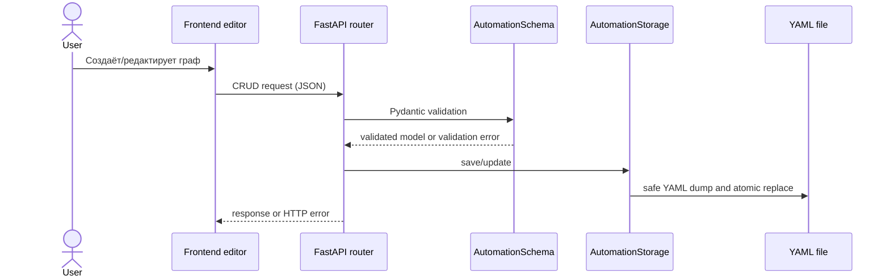
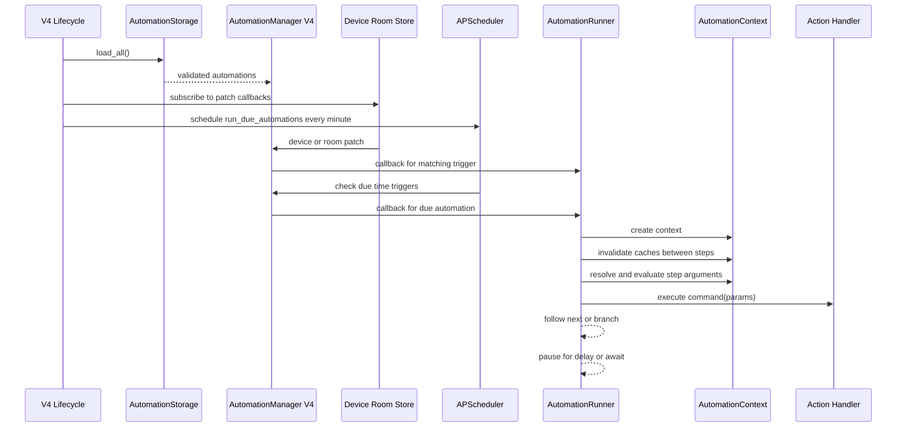

# Архитектура Automation V4

## Связанные разделы

[README](./README.md) · [Схема](./schema.md) · [Триггеры](./triggers.md) · [Шаги](./steps.md) · [Контекст](./execution-context.md) · [Хранилище](./storage.md) · [API](./api.md) · [Frontend](./frontend.md)

## Компоненты

| Компонент | Ответственность |
|---|---|
| `AutomationSchema` и модели AST | Проверка структуры, полей, дискриминаторов и ссылок в модели. |
| FastAPI router `automation_v4` | HTTP CRUD, ручной запуск, получение списка команд и возможностей выражений. |
| `AutomationStorage` | Чтение/запись YAML и проверка загруженных документов через Pydantic. |
| `AutomationManager_V4` | Индексы по времени, устройствам и комнатам; вызов callback для совпавших событий. |
| `AutomationRunner` | Выполнение шагов как графа с переходами `next`/ветками. |
| `AutomationContext` | Переменные и кэши одного запуска, проверка циклов/глубины. |
| Expression/path blocks | Разрешение аргументов и путей, вычисление AST. |
| `device_action_handler` | Реестр команд и обработка встроенной команды `set_value`. |
| Frontend Automation V4 | Формирование клиентской модели и вызовы API; детали приведены в [frontend.md](./frontend.md). |

Основные исходники: `SmartHome/app/schemas/automation/automation_v4.py`, `SmartHome/app/core/entities/automation/automation_v4.py`, `SmartHome/app/core/entities/automation/automation_context.py`, `SmartHome/app/core/state/automation_store_v4.py`, `SmartHome/app/db/repositories/automation_v4/automation_io.py`, `SmartHome/app/api/automation/automation_v4.py`.

## Общий поток данных

## Создание и сохранение

Фактические URL и методы перечислены в [api.md](./api.md); сериализация и frontend-компоненты — в [frontend.md](./frontend.md).

## Запуск и выполнение

## Жизненный цикл

1. V4 lifecycle запускает регистрацию: очищает manager, загружает YAML-автоматизации, подключает callbacks к хранилищам состояний устройств и комнат и ставит минутную задачу проверки времени.
2. При событии manager выбирает автоматизации по индексам триггеров. Временные триггеры проверяются планировщиком; устройство/комната обрабатываются при patch-обновлениях.
3. `AutomationRunner` создаёт контекст запуска и начинает с `entry` либо с шага продолжения.
4. Перед каждым шагом сбрасываются кэши контекста. Вычисляются необходимые аргументы, выполняется обработчик шага, выбирается следующий идентификатор.
5. Нормальный переход продолжается в цикле; задержка и ожидание приостанавливают текущий проход и передают продолжение scheduler/manager.

## Known Issues

- В модели есть `ScriptActionStep`, но runner не обрабатывает этот тип.
- `AwaitStep` регистрирует подписку и таймаут, но фактическое продолжение не проверяет условие триггера.
- `IntervalTimeTrigger` валиден по схеме, но не индексируется менеджером.
- Обработчики device/room trigger сейчас не проверяют сохранённое `condition`.
- Валидация схемы гарантирует существование ссылок переходов, но не является статическим анализом достижимости/бесконечных графов.

Подробности и точные последствия: [триггеры](./triggers.md), [шаги](./steps.md), [step-await](./step-await.md), [валидация](./validation.md).
