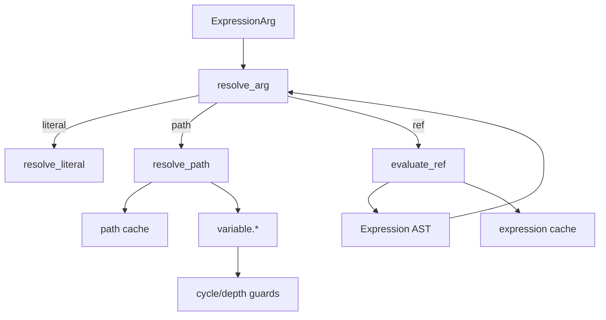

# Контекст выполнения

## Связанные разделы

[README](./README.md) · [Expressions](./expressions.md) · [Аргументы](./expression-arguments.md) · [Переменные](./variables.md) · [Пути](./path-resolution.md) · [Шаги](./steps.md) · [Ошибки](./error-handling.md)

## `AutomationContext`

`AutomationContext` создаётся для одного запуска и соединяет рабочие данные автоматизации с resolver-ами:

- `steps` и `expressions` — граф, необходимый runner/evaluator;
- `variables` — runtime параметры/значения;
- `_path_cache` — ранее разрешённые пути;
- `_expr_cache` — ранее вычисленные выражения;
- `_evaluating` и `_depth` — активная цепочка вычисления и глубина;
- `_resolving_variables` — активные имена переменных для обнаружения циклов.

При инициализации context применяет defaults из `AutomationSchema.parameters` и проверяет значения по объявленному типу. Подробности объявления — [schema.md](./schema.md), [variables.md](./variables.md).

## Разрешение и вычисление

`resolve_arg` выбирает literal/path/ref resolver. Ссылка `ref` вычисляет Expression AST с помощью того же context. `resolve_path` использует контекст для переменных и path cache.

## Рекурсия и кэши

`MAX_DEPTH = 64`. Методы входа/выхода для переменной и expression отслеживают циклы/глубину и при нарушении поднимают `ExpressionError` с цепочкой. После обработки каждого шага runner вызывает `ctx.invalidate()`, чтобы сбросить кэши перед следующим шагом: кэш предназначен для повторного использования внутри шага/вычислительной цепочки, а не для закрепления устаревших device values между шагами.

## Жизненный цикл контекста

1. Создание для автоматизации с выбранными/дефолтными переменными.
2. Вход в граф шагов.
3. Перед шагом очистка кэшей.
4. Разрешение значений и вычисление выражений с проверкой рекурсии.
5. При переходе к следующему шагу — повторное использование контекста с очисткой кэшей; при новом запуске создаётся новый context.

Для границ одного прохода и пауз `delay`/`await` см. [steps.md](./steps.md).
