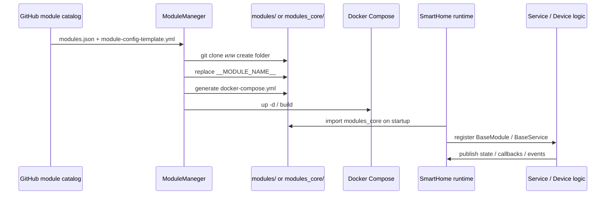

# SmartHome: архитектура самостоятельных устанавливаемых модулей

## 1. Что такое модуль SmartHome

В SmartHome модуль — это не обычная библиотека или Python-пакет. Это самостоятельный компонент платформы, который:

- устанавливается как отдельный модуль системы;
- может иметь собственную директорию, зависимости, конфигурацию и логику;
- может быть частью ядра (`type: core`) или отдельным контейнерным сервисом (`type: docker`);
- может регистрировать новые классы устройств и обеспечивать новые устройства для платформы;
- взаимодействует с общей шиной данных, системой конфигураций, очередями и WebSocket.

В проекте есть два реальных способа использования модулей:

1. Core-модули: загружаются в основной процесс `SmartHome` и используют Python-код внутри `app/moduls/moduls`.
2. Docker-модули: устанавливаются через менеджер модулей и запускаются через Docker Compose.

Главный источник понимания архитектуры — примеры в `modules_core/` и реализация менеджера модулей в `ModuleManeger/server/app/internal/module`.

## 2. Общая архитектура

```mermaid
flowchart LR
    A[GitHub: modules.json + module-config-template.yml] --> B[ModuleManeger]
    B --> C[clone_module / clone_module_repo]
    C --> D[modules/ или modules_core/]
    D --> E[generate docker-compose.yml]
    E --> F[Docker Compose / Python import]
    F --> G[BaseModule + BaseService registration]
    G --> H[servicesDataPoll + DeviceStatusStore]
    H --> I[SmartHome runtime]
    I --> J[WebSocket / RabbitMQ / MQTT]
    J --> K[Frontend + devices + automation]
```



Реальная архитектура подтверждается следующими файлами:

- `modules_core/` — эталонные real-world модули;
- `ModuleManeger/server/app/internal/module/*.py` — менеджер модулей;
- `SmartHome/app/moduls/__init__.py` — точка входа загрузки модулей;
- `SmartHome/app/core/state/module_state.py` — логика загрузки и старта модулей;
- `SmartHome/app/core/state/ObservableDict.py` — общая шина данных сервисов;
- `SmartHome/app/core/state/device_store.py` — хранилище состояния устройств;
- `docker-compose-traefik.yml` — подключение core-модулей в основной сервис;
- `ModuleManeger/docker-compose-manager.yml` — запуск менеджера модулей.

## 3. Примеры `modules_core`

В директории `modules_core` находятся реальные примеры модулей:

- `Virtual_devices`
- `mqtt_core_module`
- `yeelight_core_module`
- `zigbee2mqtt_core_module`

### 3.1. `Virtual_devices`

Расположение: `modules_core/Virtual_devices`

Назначение:
- виртуальное устройство для тестов и демонстрации модели устройства без физического IO.

Структура:

```text
Virtual_devices/
  __init__.py
  devices/
    Virtual.py
  img/
    imgVirtualDevice.png
```

Ключевые факты:

- `__init__.py` содержит `class ModuleVirtual(BaseModule): pass`;
- `devices/Virtual.py` наследует `BaseDevice`;
- `device_config` задает `virtual=True` и описывает поле `value`;
- `async_init()` загружает последние значения из кэша;
- `set_value()` переопределяет сохранение значения устройства.

### 3.2. `mqtt_core_module`

Расположение: `modules_core/mqtt_core_module`

Назначение:
- подключение SmartHome к MQTT-брокеру;
- чтение сообщений и преобразование их в обновления устройств;
- публикация команд в MQTT.

Структура:

```text
mqtt_core_module/
  __init__.py
  callback_helpers.py
  device_field_set.py
  devices/
    MQTTDevice.py
  services/
    MqttService.py
  settings.py
  utils.py
  module-config-template.yml
```

Файлы и роли:

- `__init__.py` — точка входа, реализует `Module.start()` и `Module.stop()`;
- `settings.py` — константы ключей конфигурации (`MQTT_BROKER_IP`, `MQTT_PORT`, `MQTT_USERNAME` и т.д.);
- `services/MqttService.py` — MQTT-сервис, который подключается к брокеру, подписывается на темы и вызывает callbacks;
- `devices/MQTTDevice.py` — устройство, которое отправляет команды через MQTT;
- `device_field_set.py` — обработчик входящих сообщений, превращает MQTT-топики в `DeviceEvent`;
- `utils.py` — вспомогательные функции для разбора topic tree.

Манифест:

```yaml
name: __MODULE_NAME__
name_module: mqtt_core_module
multiply: false
type: core
dependencies:
  - "paho-mqtt"
```

Путь запуска:

- `Module.start()` получает `MqttService` из `servicesDataPoll[SERVICE_POLL]`;
- регистрирует конфигурационные значения через `__config__.register_config(...)`;
- подписывается на темы `mqtt_service.subscribe("", "mqttDevice", device_set_value)`;
- вызывает `mqtt_service.restart()`.

Как модуль работает:

- при входящем MQTT-сообщении `MqttService.on_message()` вызывает `async_on_message()`;
- сервис обновляет `MQTT_messages` в `SERVICE_DATA_POLL`;
- затем вызывает зарегистрированные callbacks по topic;
- `device_set_value()` находит устройство по адресу и отправляет `DeviceEvent` в `dispatcher.emit()`.

### 3.3. `yeelight_core_module`

Расположение: `modules_core/yeelight_core_module`

Назначение:
- драйвер для Yeelight-ламп;
- типовой пример `core`-модуля устройства с полноценным API управления физическим устройством.

Структура:

```text
yeelight_core_module/
  __init__.py
  devices/
    Yeelight.py
  settings.py
  module-config-template.yml
```

Что важно:

- `__init__.py` содержит `ModuleYeelight(BaseModule): pass`;
- реальная логика находится в `devices/Yeelight.py`;
- поле `dependencies` содержит `yeelight`;
- `YeelightDevice` использует библиотеку `Bulb` и вызывает методы `set_brightness`, `set_color_temp`, `set_hsv`, `send_command`.

Логика драйвера:

- `__init__` создает `Bulb(self.data.address)`;
- `async_init()` считывает свойства лампы и автоматически добавляет поля (`state`, `brightness`, `color`, `temp`, `night_light` и др.);
- `set_value()` принимает команду из платформы и переводит ее в вызов реального устройства;
- `async_load()` собирает актуальные значения устройства и возвращает patch-обновления.

### 3.4. `zigbee2mqtt_core_module`

Расположение: `modules_core/zigbee2mqtt_core_module`

Назначение:
- мост к Zigbee2MQTT;
- автодетектирование устройств и создание моделей устройств на лету.

Структура:

```text
zigbee2mqtt_core_module/
  __init__.py
  device_field_set.py
  schemas/
    devices.py
  services/
    ZigbeeService.py
  settings.py
  utils.py
  module-config-template.yml
```

Ключевая логика:

- `ZigbeeService.start()` читает тему координатора из конфигурации;
- создает `ZigbeeServiceCoordinator(root_topic)`;
- подписывается на MQTT-подписки `bridge/devices`, `bridge/info`, `bridge/event`;
- при событии `device_interview` создается `AddDeviceSchema` и оно добавляется в очередь `__queue__.add("add", object=device)`.

Это наиболее важный пример реализации "динамического устройства" внутри модуля: модуль не хранит заранее список устройств, а создаёт их по данным, пришедшим с внешней системы.

## 4. Общие правила для всех модулей

### 4.1. Обязательные элементы

По реальным примерам можно выделить минимальный контракт.

Минимум для core-модуля:

- корневая папка модуля;
- `__init__.py`;
- класс модуля, наследующий `BaseModule`;
- `module-config-template.yml`;
- папки `devices/` и/или `services/` по необходимости;
- `settings.py` или эквивалент констант;
- встроенная логика запуска и остановки.

Минимум для docker-модуля:

- корневая папка модуля;
- `module-config-template.yml` с `type: docker` и секцией `containers`;
- `Dockerfile` и/или docker-compose-related файлы;
- точка входа контейнера;
- часто конфигурация `config`/`volumes` и Traefik labels.

### 4.2. Идентификаторы и версия

Реальный проект использует следующие поля:

- `name` — имя экземпляра, используется как уникальное имя инстанса модуля после установки;
- `name_module` — идентификатор модуля в каталоге/репозитории;
- `multiply` — признак, может ли быть несколько копий модуля;
- `type` — `core` или `docker`;
- `dependencies` — список Python-зависимостей для core-модулей.

### 4.3. Точка входа модуля

Модули наследуют `BaseModule` из `SmartHome/app/core/ports/module/baseModules.py`:

```python
class BaseModule(metaclass=ModulesMeta, scan_module=False):
    @classmethod
    async def start(cls):
        pass

    @classmethod
    async def stop(cls):
        pass
```

### 4.4. Автоматическая инициализация

В `SmartHome/app/core/entities/module/metaModules.py` объявлен `ModulesMeta`, который автоматически:

- импортирует `devices/*.py`;
- импортирует `services/*.py`;
- запускает инициализацию, когда класс `BaseModule` создается.

То есть модульный контракт строится вокруг автоматического discovery: `devices`/`services` сами находятся по файловой структуре.

## 5. Управление модулями через менеджер

Менеджер модулей расположен в `ModuleManeger/server/app/internal/module`.

### 5.1. Основные компоненты

- `search_modules.py` — поиск модулей в каталоге GitHub;
- `install_module.py` — установка обычных модулей;
- `install_module_core.py` — установка core-модулей;
- `run_module.py` — запуск и остановка модулей;
- `delete.py` — удаление модуля;
- `status.py` — проверка статуса контейнеров;
- `update.py` — обновление модуля;
- `routes/modules.py` и `routes/modules_core.py` — HTTP API.

### 5.2. Поиск модулей

`search_modules.py` выполняет:

1. загрузку `modules.json` из репозитория `SmartHome_Modules_List` через GitHub API;
2. чтение `module-config-template.yml` из корня каждого репозитория;
3. парсинг YAML в объект `ModulesConfAndLoad`;
4. сохранение кэша в `config/modules_cache.json` и `config/modules_info_cache.json`.

### 5.3. Установка обычного модуля

`clone_module_repo()` выполняет следующие шаги:

1. `git clone` репозитория в `MODULES_DIR`;
2. `replace_module_name_in_config()` заменяет `__MODULE_NAME__` на уникальное имя экземпляра;
3. `generate_docker_compose_from_module()` генерирует `docker-compose.yml` из `module-config.yml`;
4. `save_module_meta()` сохраняет `modules_meta.json` с контейнерами и путями конфигов.

### 5.4. Установка core-модуля

`install_module_core.py` делает почти то же самое, но дополнительно:

- читает `dependencies` из `module-config.yml`;
- находит контейнер `sh-core.core` / `sh-core.auth`;
- выполняет `docker exec ... poetry add dep`;
- перезапускает контейнер.

Это важно: core-модуль устанавливается не только файлом, но и в среде Python-ядра через зависимости.

### 5.5. Запуск и статус

Запуск выполняется в `run_module.py` через `docker compose ... up -d`.

Проверка состояния из `status.py` выполняет:

```bash
docker compose --env-file .env -f docker-compose.yml ps --all --format json
```

### 5.6. Остановка и удаление

Удаление модуля (`delete.py`) выполняет:

- остановку контейнеров;
- `docker compose down`;
- удаление конфигов, сохранённых в `modules_meta.json`;
- удаление директории модуля.

### 5.7. Обновление

`update.py`:

- останавливает модуль;
- удаляет контейнеры;
- удаляет папку;
- повторно клонирует и собирает модуль.

## 6. Реальная последовательность установки и запуска



Важно: больше всего реализована именно смесь двух паттернов:

- `modules_core` используется как импортируемый код внутри приложения;
- `modules/` используется как контейнерный, устанавливаемый сервис.

## 7. Как система получает и запускает модули

Точка запуска ядра находится в `SmartHome/app/moduls/__init__.py`:

```python
async def getModule():
    try:
        ModulesArray.install_dependencies(__name__)
        ModulesArray.init_modules(__name__)
        await ModulesArray.start()
    except Exception as e:
        logger.error(f"Error init modules: {e}")
```

Что происходит:

- `install_dependencies()` читает `module-config.yml` и ставит Python-пакеты;
- `init_modules()` импортирует пакеты и модули из директории `app/moduls/moduls`;
- `start()` вызывает `start()` у всех найденных модулей;
- `ModulesMeta` автоматически находит `services` и `devices`.

## 8. Жизненный цикл модуля

```mermaid
flowchart TD
    A[Публикация модуля] --> B[Поиск в modules.json]
    B --> C[clone_module_repo]
    C --> D[module-config-template.yml]
    D --> E[формирование module-config.yml]
    E --> F[генерация docker-compose.yml]
    F --> G[run_module_in_container]
    G --> H[Module.start()]
    H --> I[службы и устройства зарегистрированы]
    I --> J[обмен данными с платформой]
    J --> K[stop / update / delete]
    K --> L[удаление файлов и контейнеров]
```

## 9. Взаимодействие модулей с платформой

### 9.1. `ObservableDict` как шина сервисов

`SmartHome/app/core/state/ObservableDict.py` реализует асинхронный словарь, который:

- хранит сервисы по ключам;
- уведомляет подписчиков об изменении;
- используется как межмодульная шина состояний.

Реальные ключи конфигурации:

- `SERVICE_POLL` — список сервисов;
- `SERVICE_DATA_POLL` — общий словарь данных сервисов.

### 9.2. RabbitMQ и очереди

В `SmartHome/app/lifespan/listener.py` есть:

```python
loadServiceData = QueueConsumer(..., queue=DATA_LISTEN_QUEUE, callback=setDataService)
```

`setDataService()` получает сообщение и вызывает `service.on_load_data(body[key])` для сервиса по ключу.

Сервисные данные публикует `SmartHome/app/core/runtime/module/sender_rabbitmq.py` через `FanoutSender`.

### 9.3. MQTT

`modules_core/mqtt_core_module/services/MqttService.py` использует библиотеку `paho-mqtt` и подписывается на топики через `client.subscribe`.

### 9.4. WebSocket

`device_service` отправляет данные устройств и комнат через WebSocket. Модули также могут взаимодействовать с UI через `WebSocketMenager`.

## 10. Как модуль регистрирует новые устройства

### 10.1. Классы устройств и их регистрация

У каждого класса устройства есть метакласс `DeviceMeta` в `SmartHome/app/core/entities/device/metaDevice.py`:

```python
get_container().class_store.add(clsname, new_class)
```

Класс хранится в `DeviceClasses` (`SmartHome/app/core/state/class_store.py`).

### 10.2. Автоматическое обнаружение `devices/*.py`

`SmartHome/app/core/entities/module/utils/get_device_classes.py` сканирует `devices/` внутри каждого модуля и импортирует модули. В результате класс становится доступным системе, даже если модуль зарегистрирован через стандартный discovery.

### 10.3. Реальный сценарий: Zigbee

`zigbee2mqtt_core_module/services/ZigbeeService.py`:

- получает `device_interview`;
- формирует `AddDeviceSchema`;
- отправляет объект в очередь `__queue__.add("add", object=device)`;
- обработчик `handle_add()` вызывает `add_device()`;
- затем `init()` создаёт экземпляр класса устройства и регистрирует его в `connect_store`.

Путь создания объекта:

```mermaid
flowchart LR
    A[device_interview event] --> B[ZigbeeService._handle_device_interview]
    B --> C[AddDeviceSchema]
    C --> D[__queue__.add("add")]
    D --> E[handle_add -> add_device]
    E --> F[init()]
    F --> G[device_class(device)]
    G --> H[get_container().connect_store.add_device]
    H --> I[device ready for commands and state]
```

## 11. Описание устройства и полей

Устройство в платформе описывается через схемы в `SmartHome/app/schemas/device/device.py`.

Основные сущности:

- `DeviceSerializeSchema` — описание устройства и его полей;
- `DeviceInitFieldSchema` — описание поля при создании;
- `DeviceSerializeFieldSchema` — поле с идентификатором и атрибутами;
- `DeviceSchema` — описание вместе со значением;
- `DeviceStateEvent` — пакет обновления состояния.

Поля обычно содержат:

- `name`
- `address`
- `type`
- `low`, `high`, `enum_values`
- `read_only`
- `virtual_field`
- `unit`
- `category`
- `type_get_value`

`BaseDevice` хранит `self.fields` и предоставляет методы:

- `get_field()`
- `get_field_by_name()`
- `get_field_by_address()`
- `get_values()`
- `set_value()`

## 12. Передача состояния

Состояние хранится в `DeviceStatusStore` (`SmartHome/app/core/state/device_store.py`).

Логика:

- `dispatcher.emit(event)` создаёт `DeviceEvent`;
- `DeviceEventDispatcher.emit()` вызывает `device_store.apply_patch_async(system_name, changes)`;
- `DeviceStatusStore` обновляет `_states` и публикует patch-subscribers;
- затем `send_device_data()` отправляет данные по WebSocket;
- `sender_service` и `sender_device` отправляют изменения в RabbitMQ.

```mermaid
flowchart LR
    A[Module receives external event] --> B[dispatcher.emit(DeviceEvent)]
    B --> C[DeviceStatusStore.apply_patch_async]
    C --> D[device_store snapshot + patch]
    D --> E[WebSocket sender]
    D --> F[RabbitMQ sender]
    F --> G[UI + other services]
```

## 13. Выполнение команд

Например:

- `MQTTDevice.set_value()` формирует `address/set` или `address/field` и публикует значение через `MqttService.run_command()`;
- `YeelightDevice.set_value()` вызывает конкретные команды библиотеки `yeelight`;
- `zigbee2mqtt` через MQTT пишет команды в topic вроде `root/<device>/set`.

Логика команды всегда проходит через платформенную цепочку:

```mermaid
flowchart LR
    A[SmartHome command] --> B[connect_store.get(system_name)]
    B --> C[device.set_value(field_id, value)]
    C --> D[protocol-specific command]
    D --> E[MQTT / Zigbee / Yeelight / HTTP]
    E --> F[real device] 
    F --> G[response or state change]
```

## 14. Жизненный цикл устройства и модуля

### 14.1. При старте системы

- `SmartHome/app/lifespan/startup.py` вызывает `getModule()`;
- затем `init_all()` постепенно инициализирует все устройства.

### 14.2. При повторном запуске или восстановлении

`SmartHome/app/core/runtime/device/init.py`:

- читает устройство из БД;
- регистрирует описание в `device_store`;
- создаёт экземпляр класса устройства (`device_class(device)`);
- вызывает `async_init()`;
- добавляет устройство в `connect_store`;
- ставит его в состояние `ONLINE`/`OFFLINE`.

### 14.3. При отключении модуля

- `BaseModule.stop()` и сервисный `stop()` вызываются из цикла остановки;
- для docker-модулей это означает `docker compose stop` или `down`;
- для core-модулей это чистая остановка сервиса внутри основного процесса.

### 14.4. При удалении модуля

Менеджер модулей удаляет:

- контейнеры;
- конфигурационные пути в `modules_meta.json`;
- директорию модуля.

## 15. Практическое руководство: как сделать собственный модуль SmartHome

Ниже — реальная схема на основе найденных примеров, без выдуманных паттернов.

### 15.1. Если это core-модуль

Создайте папку внутри `modules_core/` (или в `app/moduls/moduls` при установке):

```text
my_module/
  __init__.py
  module-config-template.yml
  settings.py
  devices/
    MyDevice.py
  services/
    MyService.py
```

Содержимое `__init__.py`:

```python
from app.core.ports.module.baseModules import BaseModule

class Module(BaseModule):
    @classmethod
    async def start(cls):
        await super().start()

    @classmethod
    async def stop(cls):
        await super().stop()
```

`module-config-template.yml`:

```yaml
name: __MODULE_NAME__
name_module: my_module
multiply: false
type: core
dependencies:
  - "some-package"
```

### 15.2. Если это docker-модуль

Создайте папку для установки в `modules/`:

```text
my_module/
  Dockerfile
  docker-compose.yml
  module-config-template.yml
  src/
```

Содержимое `module-config-template.yml` должно include:

```yaml
name: __MODULE_NAME__
name_module: my_module
type: docker
multiply: false
containers:
  - name: __MODULE_NAME__
    config:
      build:
        context: .
```

### 15.3. Как регистрировать устройства

Устройство должно быть реализовано как класс, наследующий `BaseDevice`.

Типичный шаблон:

```python
class MyDevice(BaseDevice):
    device_config = ConfigSchema(...)

    async def async_init(self):
        ...

    async def set_value(self, field_id, value, *, script=False, save_status=True):
        await super().set_value(field_id, value, script=script, save_status=save_status)
        ...
```

Если устройство создаётся динамически (как в Zigbee), код создаёт `AddDeviceSchema`, затем добавляет объект в очередь `__queue__.add("add", object=device)`.

### 15.4. Как передавать состояние

Используйте:

- `dispatcher.emit(DeviceEvent(...))` для обновления устройства;
- `DeviceStatusStore.apply_patch_async(...)` для синхронизации изменений;
- `servicesDataPoll` для сервисных данных;
- `MqttService.run_command(...)` для публикации команд.

### 15.5. Как готовить модуль к публикации

- создать `module-config-template.yml`;
- обеспечить корректный `name_module`;
- добавить `dependencies` для core-модуля;
- подготовить `Dockerfile` и `docker-compose.yml` для контейнерного варианта;
- разместить модуль в репозитории, который будет считан `modules.json`;
- убедиться, что модуль можно обнаружить и установить через менеджер.

## 16. Известные ограничения и архитектурные особенности

1. Нет строгого единообразного public API для всех модулей. Основной контракт — не формальный интерфейс, а конвенции файловой структуры и метаклассов.
2. Manager использует GitHub и `modules.json`, а не локальную базу метаданных. Это значит, что каталог модулей внешне управляется репозиторием-источником.
3. Для core-модулей проверка совместимости и версии не выглядит формализованной. Есть только `name_module` и `dependencies`, без явной semver-валидации.
4. Динамическая генерация `docker-compose.yml` происходит из `module-config.yml`, но в реальных модулях нет строгой дополнительной схемы валидации.
5. Установка зависимостей core-модулей выполняется через `poetry add` внутри контейнера, а не через манифест и lock-файл на уровне репозитория.
6. В модуле `ZigbeeService` и `MqttService` есть сильная привязка к конкретным внешним системам и конфигурации, поэтому модуль фактически работает как "драйвер внешнего транспорта".

## 17. Вывод

SmartHome использует не обычную библиотечную модульность, а модель самостоятельных устанавливаемых компонентов платформы.

Реально это выглядит так:

- внешний каталог модулей (`SmartHome_Modules_List`);
- менеджер модулей (`ModuleManeger`);
- установка по GitHub + `module-config-template.yml`;
- загрузка в ядро или запуск через Docker Compose;
- автоматическое discovery `devices`/`services` по структуре файлов;
- регистрация через `BaseModule`, `BaseService`, `BaseDevice` и метаклассы;
- состояние в `ObservableDict` и `DeviceStatusStore`;
- работа с MQTT/RabbitMQ/WebSocket.

Это значит, что модуль SmartHome — это не просто кодовая библиотека, а самостоятельный, устанавливаемый блок платформы, который вступает в жизнь через менеджер, выполняет собственную логику и регистрирует новые возможности, включая устройства.
